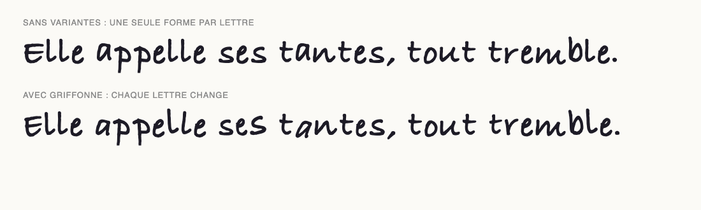
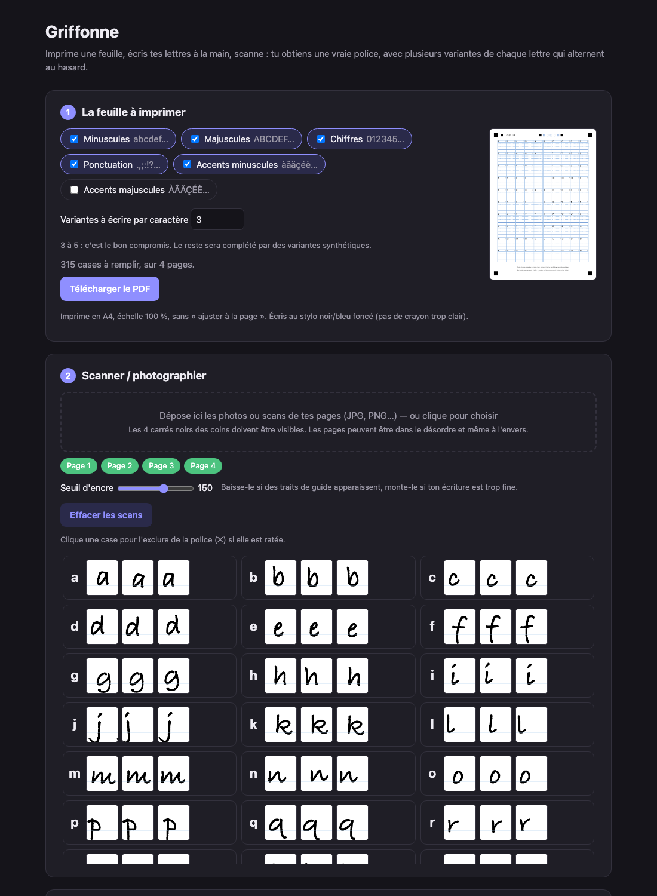
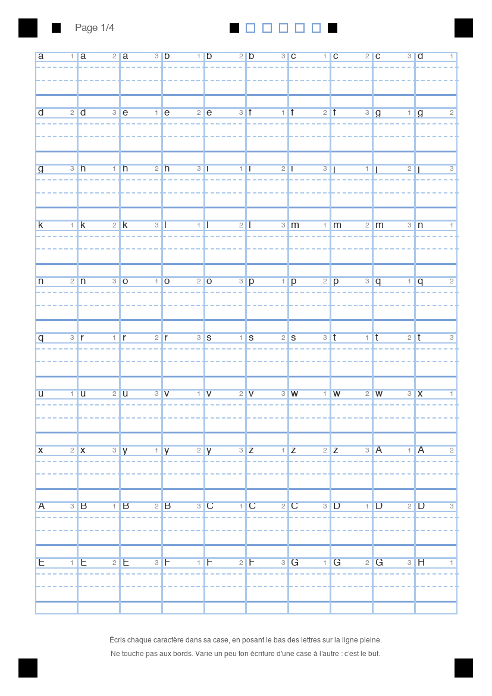

<div align="center">

# ✎ Griffonne

**Transforme ton écriture manuscrite en vraie police, avec plusieurs variantes de chaque lettre qui alternent naturellement.**

Imprime une feuille · écris · scanne · installe ta police.



<sub>Exemple généré à partir d'une police cursive système, pas d'une vraie écriture. Avec la tienne, l'effet est plus marqué.</sub>

</div>

---

## Pourquoi Griffonne ?

Une police manuscrite classique répète toujours le même « a », le même « e »… et ça se voit tout de suite : le texte fait *ordinateur*. Griffonne conserve **plusieurs versions écrites de chaque caractère** et choisit laquelle afficher d'après le contexte, comme le fait une vraie main.

- 🖨️ **Feuille modèle prête à imprimer** (PDF A4), avec lignes-guides pour respecter la ligne de base
- 📷 **Scan ou simple photo** : redressement automatique, correction des ombres, pages dans le désordre ou à l'envers
- 🔁 **Variantes naturelles** : 3 à 8 formes par caractère, jamais deux fois la même de suite
- 🧬 **Variantes synthétiques** : si tu as écrit 3 versions, Griffonne en dérive d'autres, légèrement déformées
- 🔤 **Sortie `.otf` et `.ttf`**, avec accents français, ponctuation et chiffres
- 🔒 **100 % local** : rien ne quitte ta machine

<div align="center">

</div>

## Installation

Prérequis : **Python 3.10 ou plus récent**.

```bash
git clone https://github.com/timal-o/griffonne.git
cd griffonne
python3 -m venv .venv
.venv/bin/pip install -r requirements.txt
```

Sous Windows, remplace `.venv/bin/` par `.venv\Scripts\`.

## Utilisation

```bash
.venv/bin/python app.py
```

L'interface s'ouvre sur <http://localhost:8765>. Option `--no-open` pour ne pas ouvrir le navigateur.

### 1. Imprimer la feuille

Choisis les jeux de caractères et le nombre de variantes à écrire par lettre (**3 à 5** est un bon compromis), puis télécharge le PDF.

| | |
|---|---|
| Format | A4, **échelle 100 %**, sans « ajuster à la page » |
| Stylo | Noir ou bleu foncé, trait franc. Évite le crayon à papier clair |
| Écriture | Pose le **bas des lettres sur la ligne pleine** ; laisse les descendantes (g, p, y…) passer dessous |
| Bords | Ne touche pas aux cadres et reste dans ta case |
| Variantes | Écris volontairement chaque version un peu différemment |

<div align="center"></div>

### 2. Scanner ou photographier

Dépose tes images dans la page. Chaque feuille doit montrer **les 4 carrés noirs des coins en entier**. L'ordre des pages n'a pas d'importance.

- Une photo bien éclairée suffit, un scan à 200-300 dpi est idéal.
- La galerie affiche ce qui a été extrait de chaque case. **Clique une case ratée** pour l'exclure.
- Le curseur *Seuil d'encre* : baisse-le si des traits de guide apparaissent, monte-le si ton écriture est fine.

### 3. Créer la police

| Réglage | Effet |
|---|---|
| Variantes par caractère | Nombre total de formes disponibles (réelles + synthétiques) |
| Variations synthétiques | Force des déformations des variantes générées (0 = copies exactes) |
| Espacement des lettres | Marge de part et d'autre de chaque glyphe |
| Largeur de l'espace | Largeur du caractère espace |
| Taille | Échelle globale par rapport à ce que tu as écrit |
| Arrondi des contours | 0 = angles vifs, 1,33 = très arrondi |

Télécharge le `.otf` ou le `.ttf`, double-clique pour l'installer. L'aperçu intégré permet de comparer avec et sans variantes, et « Autre tirage » change la graine aléatoire.

## Compatibilité

Le choix de la variante repose sur la fonctionnalité OpenType **`calt`** (*contextual alternates*).

| Environnement | Variantes |
|---|---|
| Navigateurs (testé dans Chrome) | ✅ |
| Logiciels de PAO (Adobe, Affinity) | ✅ attendu, non testé |
| Word, Google Docs, Canva, Pages… | ⚠️ Dépend du logiciel. S'il ignore `calt`, tu obtiens une seule forme par lettre |

La police reste utilisable partout : la forme de base de chaque lettre est toujours présente.

## Limites connues

- Le tirage est **déterministe** : un même texte donne toujours le même rendu (la variante dépend des lettres voisines, pas d'un vrai hasard à l'affichage).
- Pas de ligatures ni de lettres liées (écriture cursive continue).
- Pas de crénage : l'espacement est uniforme, réglable globalement.
- Les majuscules accentuées sont décochées par défaut pour limiter le nombre de pages.
- Les tracés sont réalisés à partir d'une image : la qualité dépend de celle du scan.

## Tester sans écrire à la main

Un script fabrique de fausses photos de feuilles remplies avec une police cursive système (macOS) :

```bash
.venv/bin/python -c "from fontcreator import project; project.save_spec(['lower','upper','digits','punct','fr_lower'], 3)"
.venv/bin/python tests/fake_scan.py       # crée work/fake/scan_*.jpg
.venv/bin/python tests/run_pipeline.py    # ingère et construit work/out/TestHand.otf
```

## Structure du projet

```
app.py                 serveur local (bibliothèque standard uniquement)
static/                interface web (HTML + JS, sans dépendance)
fontcreator/
  layout.py            géométrie de la feuille, rendu PDF
  scan.py              détection des coins, redressement, extraction des cases
  build.py             vectorisation, variantes synthétiques, table GSUB, OTF/TTF
  project.py           état du projet (dossier work/)
tests/                 génération de fausses photos, pipeline de bout en bout
docs/                  documentation technique
```

Le fonctionnement détaillé est décrit dans [docs/fonctionnement.md](docs/fonctionnement.md).

## Technologies

[fontTools](https://github.com/fonttools/fonttools) (assemblage de police, compilation des règles OpenType) ·
[OpenCV](https://opencv.org/) (redressement, seuillage) ·
[potracer](https://github.com/tatarize/potrace) (vectorisation, port Python de [Potrace](https://potrace.sourceforge.net/)) ·
[Pillow](https://python-pillow.org/) (rendu de la feuille)

## Licence

Griffonne est distribué sous licence [Creative Commons Attribution - Pas d'Utilisation Commerciale - Partage dans les Mêmes Conditions 4.0 (CC BY-NC-SA 4.0)](LICENSE).

[](https://creativecommons.org/licenses/by-nc-sa/4.0/)

- ✅ **Utiliser, copier, partager et modifier** librement.
- 📝 **Attribution** : cite l'auteur et indique les modifications que tu as faites.
- ❌ **Pas d'utilisation commerciale** : tu ne peux pas le vendre ni l'intégrer à un produit ou service payant.
- 🔁 **Partage dans les mêmes conditions** : une version modifiée doit être publiée sous la même licence.

Copyright (c) 2026 Malo

> Creative Commons ne recommande pas ses licences pour du code source (elles ne traitent pas les brevets, par exemple). Ici, elles ont l'avantage d'être très connues et reconnues par GitHub. Ce n'est pas une licence « open source » au sens de l'OSI, car elle interdit l'usage commercial.
